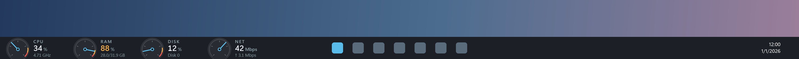
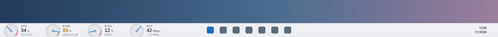
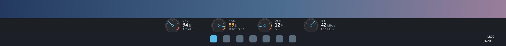
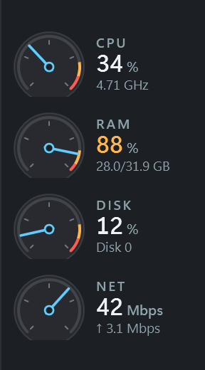

# Cluster

[](https://github.com/fotis89/pc-cluster/actions/workflows/ci.yml)
[](LICENSE)

**Your PC's vitals as car gauges, always in view.** A tachometer for CPU, boost for RAM, load for disk and a
speedometer for network, in your taskbar, docked at a screen edge, or floating in a corner.
Local-only, no admin rights, no install.




## Features

- **Four gauges**, updated every second with a damped needle swing:

  | Gauge | Like a car's | Shows |
  |---|---|---|
  | CPU | tachometer | utilisation (as Task Manager shows it) and live clock speed |
  | RAM | boost | % in use, and used / total GB |
  | DISK | load | the busiest physical disk's active time |
  | NET | speedometer | download (log scale, 0.1 Mbps to 1 Gbps) and upload |

- **Printed redlines**: digits turn amber, then red (CPU and disk at 80% / 90%, RAM at 85% / 95%).
- **Honest readings**: a sensor that can't be read shows "—", never a fake zero.
- **Three display modes**, switchable from the right-click menu or the tray icon, on any screen:
  - **In the taskbar** (default): sits in the empty space left of Start on a centred taskbar, or between your
    app buttons and the tray when icons are left-aligned. Takes no desktop space and never covers Start, app
    buttons or the tray; when apps fill the taskbar it drops gauges from the right.
  - **Docked bar**: a real Windows app bar on the top, bottom, left or right edge. Windows makes room for it,
    so maximised windows never cover it.
  - **Overlay**: a floating panel in a corner or at top/bottom centre, like a game overlay. Adjustable opacity,
    optional click-through, turns solid under the mouse and hides while a full-screen app is in front.
- **Follows your Windows theme**: light or dark (from the taskbar setting) and your accent colour for the
  needles, updated live when you change them. Turn off "Use Windows accent colour" in the menu for the default blue.
- **Sharp at any scale**: vector-drawn and per-monitor DPI aware.
- **Start at sign-in**: one click in the menu.

| Docked bar | Overlay | Left/right edge |
|---|---|---|
|  |  |  |

## Download and run

1. Download `Cluster-vX.Y.Z-win-x64.zip` from [Releases](https://github.com/fotis89/pc-cluster/releases).
2. Unzip it anywhere and run `Cluster.exe`. No installer, and no .NET needed. The very first start can take a few
   seconds while Windows Defender scans the new exe; after that it starts in about a second.
3. Windows may show **"Windows protected your PC"** because the exe isn't code-signed (signing costs money for a
   hobby project). Choose **More info → Run anyway**. You can check the download against the `.sha256` file
   from the release: `Get-FileHash .\Cluster-vX.Y.Z-win-x64.zip`.

**Using it:** right-click the gauges (or the tray icon) for the menu: mode, screen, edge or corner, opacity,
click-through, accent colour, start at sign-in and exit. In click-through overlay mode, use the tray icon.

**Uninstall:** turn off "Start at sign-in", choose Exit, then delete `Cluster.exe` and `%LOCALAPPDATA%\Cluster`.

## Privacy

- **No network connections**: no telemetry, analytics, crash upload or auto-update. The network gauge reads your
  adapter's byte counters; it finds the default-route adapter with a routing-table lookup that sends nothing.
- **No admin rights, drivers or services.**
- Writes only `%LOCALAPPDATA%\Cluster\settings.json`, an error log next to it (only if something fails), and, if you
  turn on "Start at sign-in", a `Cluster` value under `HKCU\Software\Microsoft\Windows\CurrentVersion\Run`.

## Footprint

Measured on a 24-thread desktop with the v1.0.0 release build, over 2 minutes:

| | |
|---|---|
| CPU | 0.23% of the machine on average (peak under 1%) |
| Memory | 86 MB private |
| Download | 60 MB zip; 141 MB exe (self-contained: includes the .NET runtime) |

Sensors are read once a second on a background thread; the UI only redraws while a needle is moving.

## Limitations

- **"In the taskbar" sits *over* the taskbar row; it isn't part of it.** Windows has no supported way to add
  content to the Windows 11 taskbar, and Cluster won't inject into Explorer. It's a small topmost window placed in
  the empty space, using UI Automation to see where Start and the buttons are. It sits left of Start on a centred
  taskbar, or between the last app button and the tray when icons are left-aligned. A future Windows update could
  change the taskbar enough to throw its placement off.
- **Tested on Windows 11 25H2** with screens at 100% and 125% scale, landscape and portrait. Windows 10 should work
  but isn't tested.
- **x64 only** for now.
- **Unsigned download**, so SmartScreen warns on first run (see above).
- Not included: GPU, temperatures (they need a kernel driver), history graphs.

## Build from source

You need Windows and the [.NET 10 SDK](https://dotnet.microsoft.com/download).

```powershell
dotnet test                                     # unit tests
dotnet run --project src\Cluster                # run from source
dotnet publish src\Cluster -c Release -o out    # self-contained single-file exe in out\
```

How it works:

| Part | How |
|---|---|
| CPU | PDH `Processor Information` counters: `% Processor Utility`, `% Processor Performance` × `Processor Frequency` |
| RAM | `GlobalMemoryStatusEx` |
| Disk | PDH `PhysicalDisk(*)\% Idle Time`; active = 100 − idle, busiest disk wins |
| Network | byte counters of the adapter on the default route only, so Hyper-V/VPN traffic isn't counted twice |
| Docked bar | `SHAppBarMessage` app bar; the space is released on every exit path |
| In the taskbar | UI Automation (read-only) to find the first taskbar button; a transparent topmost window over the free space |
| UI | WPF on .NET 10, gauges drawn as vectors |

```
src/Cluster/
  Native/    Windows API calls: app bar, windows, PDH, IP Helper
  Sensors/   CPU, memory, disk and network sensors + the 1-second sampler
  Model/     gauge geometry and zones, needle damping, readout formatting
  Settings/  settings file, start at sign-in, local error log
  Ui/        gauges, the three window modes, taskbar probe, tray icon and menu
tests/Cluster.Tests/   unit tests (and the offscreen renderer for the README images)
tools/measure.ps1      CPU and memory of a running copy
```

## Contributing

Issues and pull requests are welcome; see [CONTRIBUTING.md](CONTRIBUTING.md). For security problems, see
[SECURITY.md](SECURITY.md).

## License

[MIT](LICENSE) © 2026 Fotis Karagiorgos
